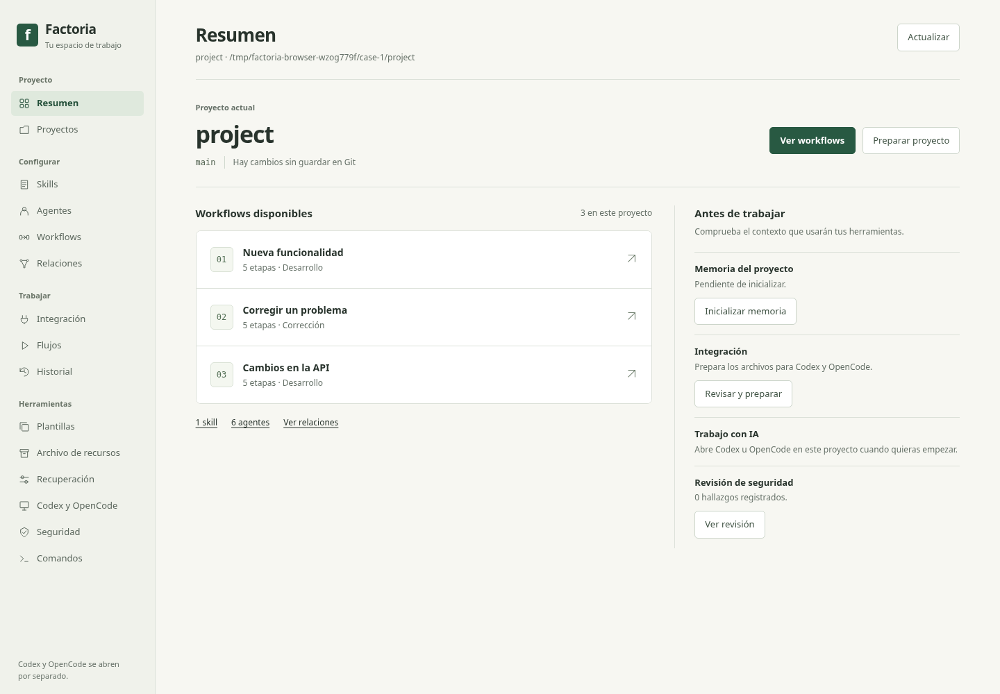

# Factoría

Factoría organiza cómo trabajas con **Codex y OpenCode** en cada repositorio.
Desde una interfaz web local puedes guardar skills, definir agentes y decidir
quién planifica, implementa y revisa cada cambio. El CLI registra el progreso,
las aprobaciones y los resultados de las comprobaciones.

**Configura el proyecto → prepara la integración → abre Codex u OpenCode → ejecuta un workflow.**



> **Versión de pruebas 0.3.0.** La instalación se realiza desde el código fuente.
> La validación en sesiones independientes y la distribución del instalador de
> Windows siguen en curso. Consulta el [estado del proyecto](docs/project-status.md).

## Instalar y abrir

Necesitas **Python 3.11 o posterior** y **Git**. Para ejecutar un workflow con IA,
abre y autentica Codex u OpenCode en el entorno donde esté el repositorio.

```text
git clone https://github.com/Sescoruela/Factoria.git
cd Factoria
python -m venv .venv
```

Activa el entorno virtual con `.\.venv\Scripts\Activate.ps1` en PowerShell o
`source .venv/bin/activate` en Bash. Después instala Factoría y abre la interfaz.

```text
python -m pip install -e .
factoria --version
factoria ui
```

## Primera prueba

Desde la carpeta de Factoría y con el entorno activado, crea un laboratorio
desechable. Usa una carpeta de destino nueva.

```text
python tools/acceptance_lab.py prepare ../factoria-lab
```

Abre Codex u OpenCode en el caso `fix` que corresponda a tu herramienta dentro
del laboratorio. Pide «Ejecuta el workflow fix-lab. Corrige sum_even para que
sum_even([1, 2, 3, 4]) devuelva 6». Comprueba que sigue las etapas, conserva
las pruebas base y te muestra la verificación antes del commit.

El [manual de uso](docs/manual-de-uso.md) incluye las carpetas de prueba, el
recorrido de una funcionalidad y la configuración de un proyecto propio.

## Enviar feedback

Abre una incidencia con tu sistema operativo, la versión de Factoría, la
herramienta usada, los pasos, el resultado esperado y lo que observaste.
Para una sugerencia, describe qué querías hacer y dónde te resultó difícil.
Usa el laboratorio o ejemplos anonimizados. [Issues](https://github.com/Sescoruela/Factoria/issues)

## Más documentación

- [Manual de uso y resolución de problemas](docs/manual-de-uso.md)
- [Integración con Codex, OpenCode y ChatGPT](docs/direct-project-integration.md)
- [Referencia del CLI](docs/cli.md)
- [Protocolo de pruebas externas](docs/acceptance/h05-protocol.md)
- [Proceso de compilación y distribución](docs/release-process.md)
- [Roadmap](docs/roadmap.md)

Para verificar el código en tu entorno, ejecuta `python -m unittest discover -s tests`.
