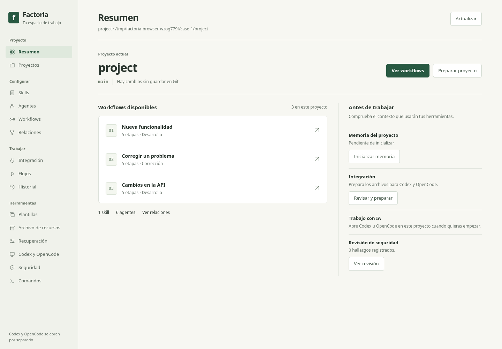
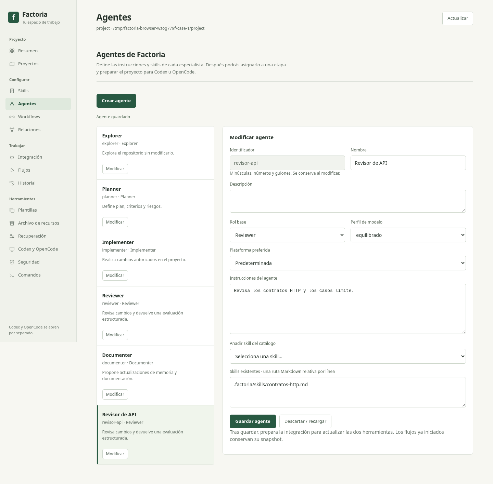
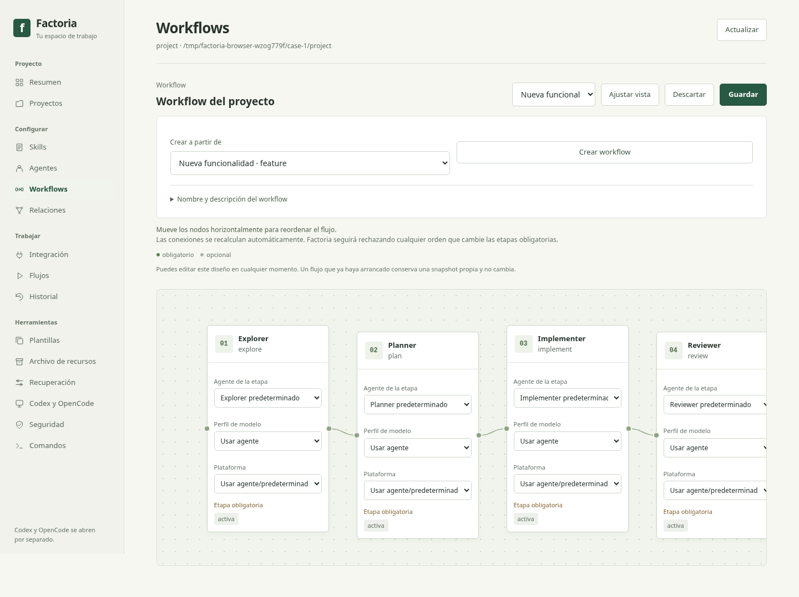

# Interfaz de trabajo — 07/11/2026

La interfaz utiliza superficies claras, un acento verde discreto, tipografía de
sistema y controles con una jerarquía constante. La navegación se agrupa por tareas:
Proyecto, Configurar, Trabajar y Herramientas. Los iconos son SVG locales y las
etapas usan números en lugar de emojis decorativos.

## Cambios de uso

- **Resumen** muestra el proyecto, sus workflows reales y las comprobaciones previas.
  Los accesos abren el workflow o panel correspondiente; los catálogos con errores
  se presentan como pendientes de revisión, no como catálogos vacíos correctos.
- **Agentes y skills** separan lista y formulario en escritorio, señalan la selección
  y explican el estado inicial sin llenar el área de tarjetas repetidas. En móvil
  se apilan conservando el formulario y sus borradores.
- **Workflows** mantiene visible la creación y recoge nombre/descripción en un
  desplegable: los básicos lo dejan cerrado; al crear o abrir uno propio se abre.
  Se reduce el espacio vacío del lienzo y las conexiones se calculan con la altura
  visible de los nodos, para llegar a sus puertos tras el cambio tipográfico.
- **Móvil** dispone de menú plegable con estado expandido, foco de teclado al
  contenido, enlace para saltar la navegación y etiquetas de campos. El scroll
  horizontal del diagrama queda dentro del lienzo.
- Los accesos del servidor clásico reutilizan `/editors` cuando requieren el editor
  completo, con autenticación existente y comprobación de borradores. Limpiar el
  token de la URL conserva ahora el fragmento de destino de esos enlaces.

Los cambios viven en `web/interface.css` y `web/interface.js`, compartidos por ambas
vistas. Se mantienen las políticas, revisiones, confirmaciones y guardados existentes.
No se añaden librerías de runtime, fuentes externas ni arranque de proveedores.

## Capturas revisadas

Proyecto de demostración creado en el fixture desechable, con una skill, un agente
propio y un workflow propio. Las rutas temporales visibles no son datos del usuario.

[Vista móvil](images/interface/mobile.png)

## Comprobaciones y límites

406 unittest correctos y 31/31 casos Chromium reales locales. Los seis casos nuevos
comprueban datos/accesos del resumen, teclado/menú móvil, ancho del viewport y
scroll del lienzo, selección inicial de proyecto, puente clásico y conexiones de
los nodos. Se conservan los recorridos de crear/editar/reabrir, borradores,
conflictos entre pestañas, fallos de guardado y recuperación H13.

Inspección visual de Resumen, Agentes, Workflow, vista clásica y móvil; viewports
1440×1000 y 390×844, con capturas de documento completo. El documento móvil no desborda su viewport de 390 px. Esto no
certifica accesibilidad WCAG completa, todos los tamaños, Firefox/Safari o Windows.
Los controles específicos de teclado y etiquetas están comprobados, no sustituyen
una auditoría completa con tecnologías de asistencia.

CSS/JS, wheel y controladores DOM/API comprobados. Evidencia con hashes:
[interface-local-evidence.json](acceptance/interface-local-evidence.json).
Actions permanece deshabilitado: sin CI remoto ni nueva aceptación de proveedores.
H05/H06/H11 siguen abiertos y no se publica una release.
